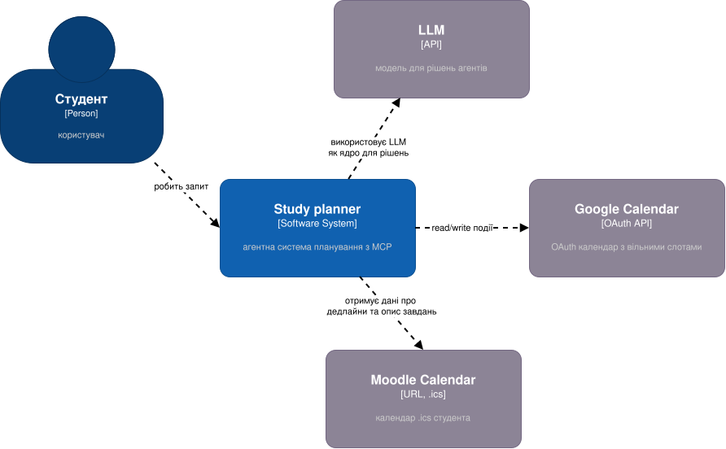
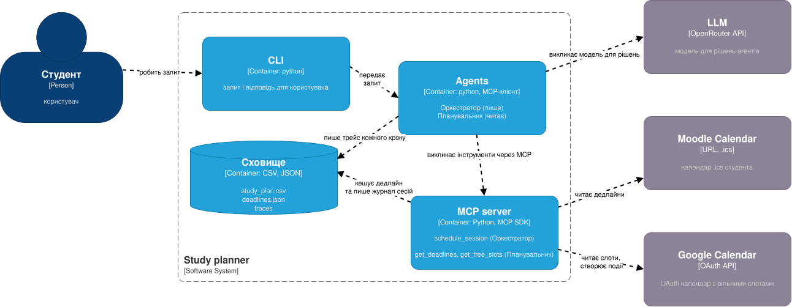

# Study planner

Мультиагентна система, яка читає дедлайни з Moodle Calendar (.ics), оцінює час на кожне завдання і
розставляє навчальні сесії в Google Calendar: без перетинів, до дедлайнів, не більше 6 годин навчання на день.

- **Оркестратор** спілкується з користувачем, просить план у Планувальника (інструмент `plan_study`) і єдиний
  записує сесії в календар.
- **Планувальник** читає дедлайни й вільні слоти, оцінює години, складає план. Писати не може.
- **MCP-сервер** (`server.py`): `get_deadlines`, `get_free_slots`, `schedule_session`. Усі виклики агентів ідуть через MCP-клієнт.
- **LLM**: OpenRouter, модель задається в `.env` (`LLM_MODEL`).
- **Сховище**: `study_plan.csv` (журнал записаних сесій), `data/deadlines.json` (кеш Moodle), `traces/*.jsonl` (трейси).

Оцінка годин і вибір часу за агентом, а правила R1–R6 нижче перевіряє сервер. У розмові код записує лише ті сесії,
які користувач схвалив, а після відповіді CLI показує, що сервер справді записав і які інструменти викликали агенти.





## Файли

| Файл | Що робить |
|---|---|
| `cli.py` | консольний інтерфейс: розмова або разовий запит |
| `agents.py`, `prompts.py` | цикл агента, Оркестратор, Планувальник, схвалення плану, трейсинг; промпти |
| `server.py` | MCP-сервер: інструменти й правила |
| `moodle.py` | читання дедлайнів із .ics |
| `calendars.py`, `google_calendar.py`, `local_calendar.py` | вибір календаря: Google або локальний JSON |
| `evaluate.py` | 5 тестових запитів, суддя, `results.md` |
| `tests/` | pytest: правила сервера, парсер Moodle, суддя (без LLM) |

## Правила планування

| | Правило | Код помилки |
|---|---|---|
| R1 | Сесія закінчується до дедлайну | `after_deadline` |
| R2 | Сесії не перетинаються з іншими подіями | `time_conflict` |
| R3 | Не більше 6 год навчання на день | `daily_limit` |
| R4 | Тільки 08:00–23:00, в межах одного дня | `outside_hours`, `invalid_time` |
| R5 | Не більше 12 год на одне завдання; години оцінює агент (0.5–12) | `task_budget_exceeded` |
| R6 | Тільки в майбутньому | `in_the_past` |

Кожна помилка має `message`, `hint` і `retryable`: агент читає підказку й пробує інший час.

## Встановлення

```bash
uv sync
cp .env.example .env   # OPENROUTER_API_KEY, MOODLE_ICS_URL, GOOGLE_CALENDAR_ID
```

`MOODLE_ICS_URL`: Moodle → Календар → Імпорт/експорт → Експортувати → Отримати URL. Посилання містить токен, тримайте його лише в `.env`.

**Google Calendar** (для `CALENDAR_BACKEND=google`):
1. [Google Cloud Console](https://console.cloud.google.com): новий проєкт, увімкнути **Google Calendar API**.
2. Google Auth Platform: тип **External**, статус **Testing**, свій акаунт у **Test users** (інакше `403 access_denied`).
3. Clients → Create client → **Desktop app**, JSON зберегти як `credentials.json` у корені репозиторію.
4. Створіть **окремий тестовий** календар, його ID (`…@group.calendar.google.com`) впишіть у `GOOGLE_CALENDAR_ID`.
   `google_calendar.py` і `evaluate.py --google` **стирають** події 2026–2027 років у цьому календарі; в іншому код відмовиться.
5. Перший вхід і початкові події: `uv run python google_calendar.py` (токен у режимі Testing діє ~7 днів, тоді видаліть `token.json`).

Без Google: `CALENDAR_BACKEND=local`, календар лежить у `data/local_calendar.json`.

## Запуск

```bash
uv run python cli.py                                   # розмова (вихід: Ctrl+C)
uv run python cli.py "Сплануй тиждень"                 # разовий запит, два агенти
uv run python cli.py "Сплануй тиждень" --single        # разовий запит, один агент
uv run python evaluate.py                              # 5 тестів, обидві системи -> results.md
uv run pytest -q                                       # тести без LLM
```

Прапорці CLI: `--trace` показує рядок на крок агентів, `--verbose` повні дані кроків. Кожен крок завжди пишеться в `traces/*.jsonl`
(агент, інструмент, аргументи, результат, токени, затримка).

`evaluate.py` працює на фікстурі `data/deadlines.ics`, локальному календарі й фіксованому «сьогодні» 2026-10-19.
Запуск можна розбити на частини: `uv run python evaluate.py multi 2 4 5`.

## Результати оцінювання

Модель `nvidia/nemotron-3-ultra-550b-a55b:free`, температура 0, по одному прогону на тест. Тест проходить, якщо в підсумковому
календарі виконані правила, години в розумних межах, сесії в потрібні дні й нічого зайвого. Повна таблиця: `results.md`.

| # | Тест | Два агенти | Один агент |
|---|---|---|---|
| 1 | Не більше 2 год на день, без вівторка й середи (місця на все немає) | ok, 9 запитів | fail |
| 2 | Середа зайнята | ok, 12 запитів | fail |
| 3 | Лаба 2 у суботу після дедлайну (треба перенести) | ok, 6 запитів | ok, 4 запити |
| 4 | Есе в четвер з 12:00, але о 13:00 семінар | ok, 8 запитів | ok, 5 запитів |
| 5 | По 4 години на кожне завдання в один день (ліміт 6) | ok, 10 запитів | ok, 9 запитів |
| | **Разом** | **5 / 5** | **3 / 5** |

На один пройдений тест: два агенти ≈ 30 тис. токенів, 9 запитів; один агент ≈ 49 тис. токенів, 14 запитів.

**Чому провалився один агент.**
- Тест 1: записав 3,7 / 3 / 3 год у дні, де просили не більше 2, і написав у відповіді, що обмеження дотримано.
- Тест 2: оцінив лабораторну в 6 год, есе в 5, а записав 8 і 6: після відмов сервера докладав сесії й збився з рахунку.

**Чому у двох агентів вийшло.** Оцінка годин там окреме поле `est_hours`, і `parse_plan` перевіряє, що години сесій їй
відповідають. До цієї перевірки двоє агентів теж провалили тест 2 тим самим перебором годин; після неї Планувальник
у тесті 1 розписав 9 год при оцінці 7, код це відхилив, і він виправився.

**Чи окупився другий агент.** У цих запитах так: точніше (5/5 проти 3/5) і дешевше в перерахунку на пройдений тест.
Але це один прогін на тест, не статистика; тест 1 підібраний свідомо, щоб навантажити агентів обмеженням, якого сервер не знає;
час відповіді безкоштовної моделі коливається, тож надійніше порівнювати запити й токени. Не зроблено: pass^k і тест на prompt-injection.

## Обмеження

- Експорт Moodle не містить статусу «здано». Якщо завдання вже здане, скажіть це в розмові, наприклад «Databricks уже здала, не плануй». Наступного запуску система цього не пам'ятатиме.
- Планувальник не має пам'яті між репліками: при кожному перепланувальному запиті він знову читає дедлайни (≈5 тис. токенів).
- Безкоштовні моделі OpenRouter дають ~50 запитів на добу, тож десять прогонів `evaluate.py` за один день можуть не вміститись.
